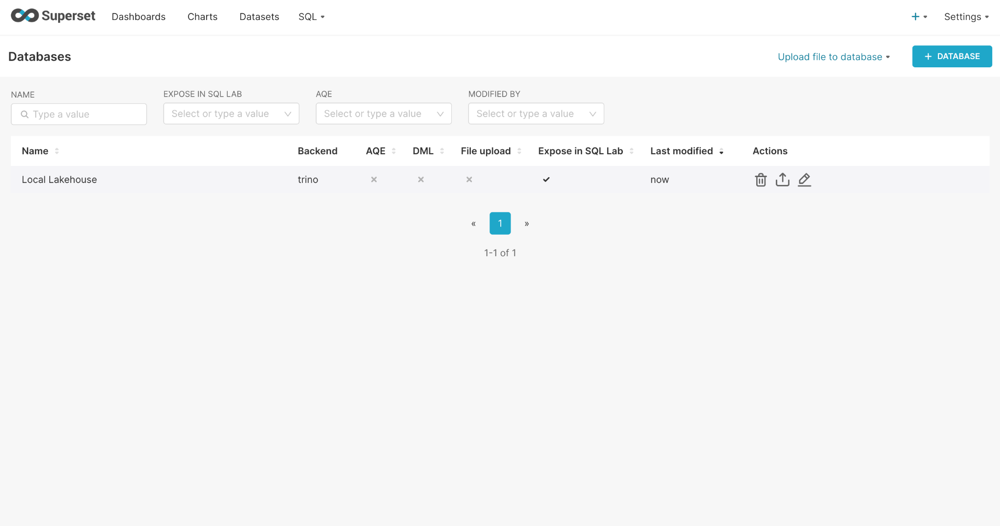
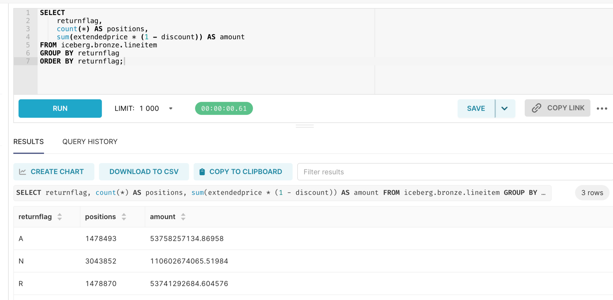
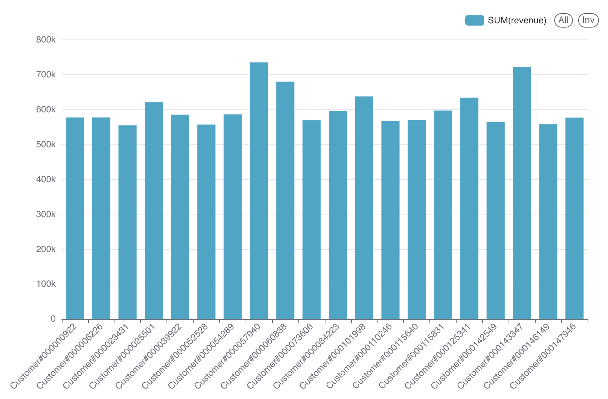

# Отчёт по практической работе №1
## Развёртывание локального Lakehouse, ELT и сравнение форматов/сжатия

**Выполнила:** Велиева Сабина  
**Вариант:** 2 — Q10 «Returned Item Reporting»  
**Масштаб:** TPC-H sf1

Развёрнут локальный Lakehouse на MinIO, PostgreSQL, Lakekeeper и Trino. Выполнены загрузка исходных данных, преобразования Bronze → Silver → Gold, сравнение четырёх комбинаций форматов и сжатия, проверка результата Q10, schema evolution и time travel. Apache Superset подключён к Trino; выполнен запрос к Bronze и построена диаграмма по Gold.

## 1. Вариант и масштаб

| Поле | Значение |
|---|---|
| ФИО (как в VK Education) | Велиева Сабина |
| Вариант | 2 — Q10 «Returned Item Reporting» |
| Масштаб | `sf1` |
| Обоснование | Для выполнения работы выбран масштаб SF1 из-за малого объёма свободной памяти на ноутбуке |

Запрос определяет 20 клиентов с максимальной суммой `extendedprice × (1 − discount)` по возвращённым позициям заказов за IV квартал 1993 года. Отбор квартала выполняется по **дате заказа**, а признак возврата — по `returnflag = 'R'`. Сумма характеризует стоимость возвращённых позиций с учётом скидки; её нельзя интерпретировать как чистую прибыль.

## 2. Сервисы и обоснование выбора

| Сервис | Роль в стеке | Почему выбран |
|---|---|---|
| MinIO | Хранение файлов данных и Iceberg-метаданных в бакете warehouse | S3 API позволяет изучить объектное хранилище локально, без облачного аккаунта. SQL-обработку выполняет отдельный движок. |
| PostgreSQL | Служебная БД Lakekeeper | Транзакционная БД для состояния каталога. Строки TPC-H в эту БД не загружаются. |
| Lakekeeper | Iceberg REST Catalog | Позволяет отделить каталог от SQL-движка и использовать стандартный REST-интерфейс. |
| Trino | Генерация TPC-H, ELT, SQL и измерения | Встроенный коннектор tpch генерирует исходные данные, а Iceberg-коннектор читает и записывает таблицы через REST-каталог. Отдельный загрузчик данных не требуется. |
| Superset | BI и SQL Lab | Подключается к Trino через SQLAlchemy-драйвер. Можно исследовать Bronze и строить диаграмму по Gold без копирования таблиц в BI. Для данной работы дополнительные Spark/Doris/StarRocks не нужны. |

Перечень **фактически запущенных** контейнеров сохранён в `results/docker-ps.txt`. Файл `results/images.json` фиксирует образы запуска. В работе использовались Trino 483, PostgreSQL 17, Superset 4.1.2 и MinIO RELEASE.2025-04-22T22-12-26Z (сборка coollabsio). Lakekeeper запускался с изменяемым тегом `latest-main`: это ограничение воспроизводимости; при повторении следует фиксировать digest образа, а не полагаться только на имя тега.

### Скрипты развёртывания

Полная конфигурация — `docker-compose.yml`; настройки движка — `trino/`; BI — `superset/`. Команда `docker compose up -d --build` запускает сервисы, создаёт бакет и применяет миграции PostgreSQL. Затем `python3 run.py --fio "Велиева Сабина"` инициализирует Lakekeeper, загружает данные, выполняет ELT и измерения. Скрипт `start.command` объединяет эти действия. Точные выполненные SQL и время каждого запроса сохраняются в `results/queries.jsonl`.

Команды запуска:

```bash
bash start.command --fio "Велиева Сабина"
# Повторный запуск скрипта после исправлений, при работающих контейнерах:
python3 run.py --fio "Велиева Сабина"
```

Контейнеры проверены командой `docker compose ps`: MinIO работал, PostgreSQL, Lakekeeper, Trino и Superset имели статус healthy. Развёртывание автоматизировано: отдельная задача создаёт бакет warehouse, задача migrate подготавливает служебную БД Lakekeeper; скрипт инициализирует каталог и warehouse, затем выполняет SQL через Trino REST API.


## 3. Разбор запроса

| Таблица TPC-H | Нужные колонки | Применение |
|---|---|---|
| customer | custkey, name, acctbal, nationkey, address, phone, comment | custkey связывает клиента с заказами; nationkey — со страной; остальные поля выводятся и участвуют в GROUP BY |
| orders | orderkey, custkey, orderdate | orderkey связывает заказ с позициями, custkey — с клиентом, orderdate ограничивает квартал |
| lineitem | orderkey, linenumber, extendedprice, discount, returnflag | Фильтр R; вычисление суммы с учётом скидки; linenumber вместе с orderkey используется для проверки уникальности позиции |
| nation | nationkey, name | Соединение по nationkey, вывод названия страны |

У tpch-коннектора Trino названия колонок не имеют префиксов `c_`, `o_`, `l_`, `n_`. В Bronze сохранены нужные колонки без преобразования значений. Полный запрос находится в `sql/q10.sql`. Дополнительная сортировка по custkey делает порядок воспроизводимым при равной выручке.

## 4. Медальон

### Bronze — исходные данные

Четыре физические Iceberg-таблицы Parquet/ZSTD находятся в `iceberg.bench_parquet_zstd`. На них ссылаются четыре представления `iceberg.bronze`, чтобы не создавать вторую физическую копию. В таблице ниже показан вес файлов **физических таблиц**, а не вес представлений. Другие комбинации форматов хранятся отдельно в тестовых схемах.

| Таблица | Колонки |
|---|---|
| customer | custkey, name, acctbal, nationkey, address, phone, comment |
| orders | orderkey, custkey, orderdate |
| lineitem | orderkey, linenumber, extendedprice, discount, returnflag |
| nation | nationkey, name |

| Таблица | Строк | Вес данных, МБ | Формат | Сжатие | Партиционирование |
|---|---:|---:|---|---|---|
| customer | 150000 | 7.588817 | PARQUET | ZSTD | нет |
| orders | 1500000 | 6.983746 | PARQUET | ZSTD | нет |
| lineitem | 6001215 | 33.488312 | PARQUET | ZSTD | нет |
| nation | 25 | 0.000606 | PARQUET | ZSTD | нет |

Parquet выбран для чтения нужных колонок в аналитических запросах. ZSTD — исходный выбор для компромисса между объёмом и затратами распаковки; выбор подтверждён результатами измерений в разделе 5. Партиционирование отключено: для локального sf1 важно не дробить небольшой набор на множество файлов. Фильтр по дате всё равно применяется в Silver. Партиционирование orders по месяцу имеет смысл отдельно проверять при росте масштаба; в этом эксперименте оно не смешивается с влиянием формата и кодека.

### Silver — проверка, отбор и обогащение

| Таблица | Колонки и преобразования |
|---|---|
| customer_nation | custkey, name, acctbal, nation, address, phone, comment; название страны присоединяется по nationkey |
| returned_order_items | custkey, orderkey, orderdate, linenumber, extendedprice, discount, net_revenue; квартал и R, проверка цены/скидки, расчёт net_revenue |

| Таблица | Строк | Вес данных, МБ | Формат | Сжатие | Партиционирование |
|---|---:|---:|---|---|---|
| customer_nation | 150000 | 7.603909 | PARQUET | ZSTD | нет |
| returned_order_items | 114705 | 1.778221 | PARQUET | ZSTD | нет |

Сохраняются типизированные даты и исходные значения клиента. Изменение адреса/comment, округление исходных сумм и произвольная дедупликация не нужны: они могли бы изменить Q10. До принятия результата проверяются уникальность `(orderkey, linenumber)`, отсутствие позиций без заказов и заказов без клиентов, допустимость скидки `[0;1]`, неотрицательность цены и сохранение количества клиентов при соединении со странами. Локальный запуск завершился успешно: проверки качества и сопоставление Gold с исходным Q10 пройдены. Дубликаты в скрипте вызывают ошибку, а не удаляются молча. Количество строк customer_nation совпало с количеством клиентов Bronze — 150 000.

Обе таблицы используют Parquet/ZSTD без партиций. Здесь читается уже отобранный квартал, а разбиение небольшой таблицы по дополнительным признакам увеличило бы количество файлов.

### Gold — витрина

| Таблица | Колонки |
|---|---|
| q10_top20 | custkey, name, revenue, acctbal, nation, address, phone, comment |

| Таблица | Строк | Вес данных, МБ | Формат | Сжатие | Партиционирование |
|---|---:|---:|---|---|---|
| q10_top20 | 20 | 0.003221 | PARQUET | ZSTD | нет |

Витрина агрегирует Silver по клиенту и оставляет топ-20. Для 20 строк партиционирование нецелесообразно. Единый Parquet/ZSTD упрощает стек; на столь маленькой таблице служебные расходы важнее выбора кодека. `ORDER BY` применяется также при чтении Gold: CTAS не гарантирует порядок последующего SELECT.

## 5. Тесты производительности

### Методология

Во всех комбинациях используются одинаковый sf, одинаковые колонки и отсутствие партиционирования. Четыре схемы: Parquet/GZIP, Parquet/ZSTD, ORC/ZSTD и ORC/SNAPPY. Замер записи — сумма времени четырёх CTAS через клиентский REST API; включает генерацию tpch, передачу запроса, выполнение и commit. `ANALYZE` выполняется одинаково для всех таблиц и не входит в время записи.

Затем Q10 читается именно из соответствующего Bronze, а не из готового Gold. Один первый запуск учитывается отдельно, после него выполняется пять повторов; приводятся медиана, минимум и максимум. Первый запуск **не считается гарантированно холодным**: ОС и MinIO могут сохранять кэш после записи. Нельзя считать различия одной последовательности строгим доказательством превосходства кодека. Для более строгого теста следует повторять эксперимент с изменением порядка комбинаций; сохранять одинаковые ресурсы Docker и исключить параллельную нагрузку.

Размер — `sum(file_size_in_bytes)` по `$files` четырёх таблиц текущего снапшота, делённый на 1 000 000. Это фактический размер data-файлов, без manifest/metadata и старых снапшотов. `SHOW STATS` не используется как измерение физического веса. Результаты — `results/benchmark.csv`, условия запуска — `results/environment.json`.

| Формат | Сжатие | Запись, с | Первый Q10, с | Медиана тёплого Q10, с | Мин., с | Макс., с | Байты данных | МБ данных |
|---|---|---:|---:|---:|---:|---:|---:|---:|
| PARQUET | GZIP | 8.169217 | 1.213501 | 0.623834 | 0.595951 | 0.79856 | 48195795 | 48.195795 |
| PARQUET | ZSTD | 3.760178 | 1.012157 | 0.466522 | 0.441298 | 0.557374 | 48061481 | 48.061481 |
| ORC | ZSTD | 4.125245 | 0.573001 | 0.486828 | 0.47269 | 0.52145 | 53123544 | 53.123544 |
| ORC | SNAPPY | 3.263938 | 0.480063 | 0.483156 | 0.452936 | 0.511659 | 75202374 | 75.202374 |

На этой машине наименьшая медиана тёплого Q10 получена для PARQUET/ZSTD: 0.466522 с; наименьший размер данных — PARQUET/ZSTD: 48.061481 МБ. Это локальные измерения, а не универсальный рейтинг кодеков.

Для каждого прогона проверяется совпадение всех 20 строк с исходным Q10. Выручка сравнивается с абсолютным допуском 0,000001 и относительным 10⁻¹², поскольку порядок суммирования чисел с плавающей точкой в разных планах может различаться. Идентификаторы и текстовые поля должны совпасть точно.

## 6. Осмысление и работа с инструментами

### 6.1. Понять и объяснить

| Вопрос | Ответ |
|---|---|
| Зачем нужны большие данные и lakehouse? | Lakehouse разделяет хранение и вычисления: файлы размещаются в объектном хранилище, SQL выполняет движок, каталог управляет доступом к таблицам. Iceberg добавляет снапшоты, согласованное состояние и эволюцию схемы. Это полезно при большом объёме истории и нескольких движках. Для малых транзакционных задач обычная БД часто проще; sf1 здесь нужен для обучения архитектуре. |
| Что происходит при schema evolution? | В отдельной копии Silver добавляется source_note VARCHAR и переименовывается в data_source. Старые строки читаются с NULL в новой колонке. Вставленная копия одной строки создаёт новый снапшот; изменения основной витрины не требуются. Проверка не предполагает, что откат data-снапшота обязательно отменит изменения схемы. |
| Как восстановить снапшот? | Сохранить snapshot_id до INSERT, проверить чтение старой версии, затем вызвать rollback_to_snapshot. Пример ниже и results/time_travel.sql используют настоящий ID локального запуска. Проверяются количества строк до вставки, после вставки, в старой версии и после отката. |

```sql
SELECT snapshot_id
FROM iceberg.demo."customer_nation$snapshots"
ORDER BY committed_at DESC LIMIT 1;

-- Сохранённый ID снапшота локального запуска:
SELECT * FROM iceberg.demo.customer_nation
FOR VERSION AS OF 2884159182053332328;
ALTER TABLE iceberg.demo.customer_nation
EXECUTE rollback_to_snapshot(2884159182053332328);
```

Демонстрация выполняется на `iceberg.demo.customer_nation`, копии Silver. Главная таблица Silver остаётся пригодной для повторной проверки Q10. Проверки и ID записываются в `results/checks.json`.

### 6.2. Подключение Superset

| Инструмент | Причина выбора |
|---|---|
| Apache Superset | Поддерживает Trino, SQL Lab и диаграммы; пригоден для исследования Bronze и представления Gold. |

Superset развёрнут в Docker и подключён к Trino. В разделе Database Connections создано подключение **Local Lakehouse** с SQLAlchemy URI `trino://student@trino:8080/iceberg`; включена опция **Expose in SQL Lab**. Подключение и выбранный движок показаны на рисунке 1.



*Рисунок 1 — подключение к Lakehouse и включённый доступ через SQL Lab.*

В SQL Lab выбраны подключение Local Lakehouse и схема bronze. Выполнен запрос, группирующий исходные позиции по признаку возврата:

```sql
SELECT returnflag, count(*) AS positions,
       sum(extendedprice * (1-discount)) AS amount
FROM iceberg.bronze.lineitem
GROUP BY returnflag
ORDER BY returnflag;
```

| returnflag | Количество позиций | Сумма с учётом скидки |
|---|---:|---:|
| A | 1 478 493 | 53 758 257 134,86958 |
| N | 3 043 852 | 110 602 674 065,51984 |
| R | 1 478 870 | 53 741 292 684,604576 |

Общее количество позиций — **6 001 215**, что совпадает с Bronze.lineitem. Этот запрос показывает исследование исходного слоя и не ограничен IV кварталом 1993 года. Его суммы отличаются от результата Q10, где дополнительно применён фильтр даты заказа.



*Рисунок 2 — выполнение SQL по Bronze через Superset → Trino → Iceberg.*

Для визуализации итогов создан dataset **gold.q10_top20**. В редакторе выбран Bar Chart: X-Axis — `name`, Metrics — `SUM(revenue)`. Построена вертикальная диаграмма с 20 столбиками; подписи клиентов повёрнуты на 45° для читаемости. Категории расположены по имени клиента; состав топ-20 определяется запросом Gold, а не порядком столбиков на диаграмме. По вертикальной оси показана сумма стоимости возвращённых позиций с учётом скидки.



*Рисунок 3 — топ-20 клиентов по стоимости возвращённых позиций заказов за IV квартал 1993 года.*

Superset обращается к данным через Trino; данные не загружались в отдельную таблицу BI и остаются в MinIO. Скриншоты подтверждают подключение, чтение Bronze и построение визуализации по Gold.

## 7. Выводы

Реализован полный ELT для Q10: из четырёх исходных таблиц Bronze сформированы таблицы Silver, а затем витрина Gold из 20 клиентов; результат совпал с исходным запросом. В локальном эксперименте Parquet/ZSTD дал наименьший объём data-файлов (48,061481 МБ) и наименьшую медиану тёплого Q10 (0,466522 с), поэтому выбран для рабочих слоёв. По сравнению с Parquet/GZIP время записи сократилось примерно на 54%, медиана Q10 — на 25%, а объём — всего на 0,28%; различия медиан Parquet/ZSTD и обеих ORC-комбинаций невелики и не доказывают универсального превосходства формата. На отдельной копии Silver проверены добавление и переименование колонки, чтение старого снапшота и восстановление количества строк после отката. Подключение Superset позволило исследовать Bronze и визуализировать Gold через тот же SQL-движок.
